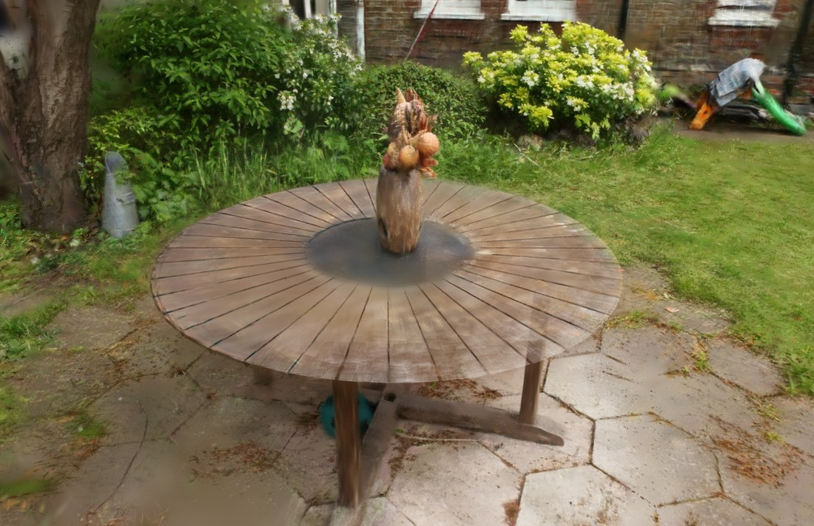
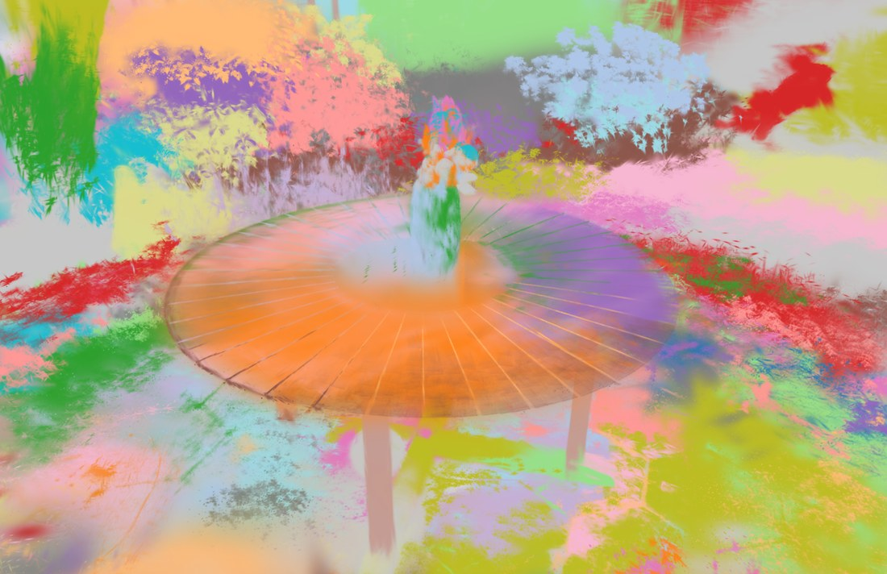
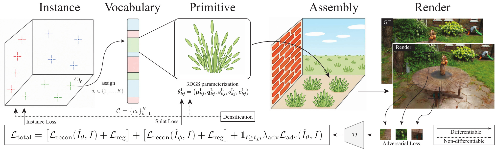
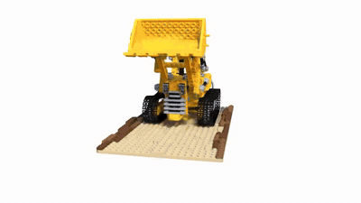
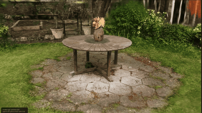
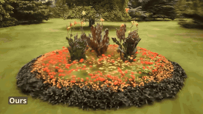

<div align="center">
  <picture>
    <source media="(prefers-color-scheme: dark)" srcset="docs/assets/scion_logo_dark.png">
    
  </picture>
  <h1>Scene Composition with Instanced Neural Primitives</h1>
  <p>
    William Koch, Amogh Joshi, Cyrus Vachha, Cheng Zheng, Felix Heide<br>
    Princeton University<br>
    NeurIPS 2026
  </p>
  <p>
    <a href="https://princeton-computational-imaging.github.io/SCION/">Project page</a> |
    <a href="https://arxiv.org/abs/2610.02322">Paper</a>
  </p>
</div>

| Reconstruction | Primitive used by each instance |
|---|---|
|  |  |

Real-world scenes are compositional: bricks, blades of grass, pebbles and leaves
recur everywhere, yet most 3D Gaussian Splatting methods fit millions of
independent Gaussians per scene. SCION replaces them with a small vocabulary of
reusable primitives, each a bundle of Gaussians, and lightweight instances that
place transformed copies of them throughout the scene. We fit this
representation to multi-view captures with a joint optimization over discrete
and continuous parameters, combining densification of both splats and
instances with an adversarial loss that keeps shared primitives sharp. SCION
keeps high quality at 1.2 MB and supports instance-level editing and animation
without retraining.



Instances start from the sparse COLMAP points and are grouped into reusable
primitives with DINOv3 features. Each instance renders the splats of its
primitive, and image losses, an adversarial loss and densification update both
the primitives and the instances. [docs/codebook_architecture.md](docs/codebook_architecture.md)
walks through the model in code.

<p align="center">
  
  
  
</p>

LEGO taken apart into its primitives; brushed instances reassigned to a grass
primitive; the same wind on 3DGS (left half) and SCION (right half).

## Quickstart

On Linux with an NVIDIA GPU and [pixi](https://pixi.sh/latest/#installation):

```bash
git clone https://github.com/princeton-computational-imaging/SCION && cd SCION
pixi install && pixi run tmc3
pixi run python -m scion.train dataset=mipnerf360 scene=garden variant=ours_small
```

Training needs the scene in `data/garden/` (`bash scripts/download_data.sh mipnerf360`,
see [Data](#data)) and access to the DINOv3 weights (see below).

## Installation

`pixi install` creates the environment we use, pinned in `pixi.lock`: Python
3.10, PyTorch 2.8 with CUDA 12.8, gsplat 1.5.3, the optional CUDA kernels in
`scion-cuda/` (about 1.3x faster training; see
[docs/cuda_architecture.md](docs/cuda_architecture.md)), the live viewer,
[COLMAP](https://colmap.github.io), and the CUDA compiler, g++ and CMake to
build the kernels. `pixi run tmc3` builds `tmc3` (MPEG
G-PCC) for the compressed file. Run the commands in this README inside
`pixi shell`, or prefix them with `pixi run`. The NVIDIA driver must support
CUDA 12.8. The first run compiles gsplat's CUDA kernels, which takes a few
minutes.

To install into an environment of your own instead (conda, venv), start from
PyTorch with CUDA and a matching CUDA toolkit (`nvcc`), then:

```bash
pip install -e '.[viewer]'
pip install -e scion-cuda/ --no-build-isolation   # optional CUDA kernels
bash scripts/setup/build_tmc13.sh                 # tmc3, needs CMake and g++
```

Synthetic-NeRF scenes and your own data also need `colmap` on `PATH`.

We tested on RTX 5090 and RTX A6000 GPUs. SCION always runs on a CUDA GPU.
The optional CUDA extension replaces one step, expanding every instance into
its primitive's Gaussians, with a custom kernel. Without it, that step runs as
standard PyTorch operations, still on the GPU, and everything else
(rasterization with gsplat, the optimizer) is the same. "PyTorch" vs "CUDA" in
our timings means these two versions of that one step.

SCION groups instances into primitives using
[DINOv3](https://github.com/facebookresearch/dinov3) features. The weights are
gated, so accept Meta's license for
[`dinov3-vitl16`](https://huggingface.co/facebook/dinov3-vitl16-pretrain-lvd1689m)
and log in to Hugging Face (`hf auth login`) before the first run.

## Data

SCION reads scenes in the format the datasets ship in, the same as
[3D Gaussian Splatting](https://github.com/graphdeco-inria/gaussian-splatting):

- **Real scenes** ([Mip-NeRF 360](https://jonbarron.info/mipnerf360/), and
  Tanks & Temples and Deep Blending from the
  [3DGS bundle](https://repo-sam.inria.fr/fungraph/3d-gaussian-splatting/datasets/input/tandt_db.zip))
  are COLMAP reconstructions: `images/` (and downscaled `images_N/`) with an
  undistorted pinhole model in `sparse/0/`.
- **[Synthetic-NeRF](https://drive.google.com/drive/folders/128yBriW1IG_3NJ5Rp7APSTZsJqdJdfc1)**
  uses the NeRF Blender format: `transforms_{train,val,test}.json` with
  `train/`, `val/` and `test/` images.

To download and extract them into `data/<scene>/`:

```bash
bash scripts/download_data.sh all   # or mipnerf360, tandt (with Deep Blending), synthetic, campus
```

Synthetic-NeRF is only on Google Drive, so save `nerf_synthetic.zip` in
`data/_archives/` first. Its scenes ship no SfM points, so we run COLMAP on
them: it matches features across the training views and triangulates them
with the dataset's poses held fixed. The first run on a scene does this on
its own (about two minutes on the CPU; `python -m scion.data.synthetic
data/lego` does it without training) and saves the points as
`colmap_points.ply` in 3DGS's PLY format. For a fair comparison, the key
baselines we compare against on Synthetic-NeRF, HAC++ and ContextGS, start
from the same points (copied to `points3d.ply`) instead of the random points
3DGS-based methods start from on this dataset.

The dataset configs follow the 3DGS evaluation protocol: every 8th image of
the real scenes is held out (Synthetic-NeRF uses its test split), and
Mip-NeRF 360 uses `images_4` outdoors and `images_2` indoors.

### Campus ID/OOD scenes

For the out-of-distribution experiment in the paper's appendix we captured two
handheld scenes on the Princeton campus, `mather_sundial` and
`mccosh_walkway`, hosted on
[Hugging Face](https://huggingface.co/datasets/pci-lab/scion-data) under
[CC BY-NC 4.0](https://creativecommons.org/licenses/by-nc/4.0/).
Each scene is in the COLMAP layout above (undistorted, ground-levelled
`sparse/0/`) plus a `split.json` that lists the training images and three
groups of test images: `id` (every 8th frame of the main walk around the
subject, whose other frames are the training images), `sideways` (frames that
look at the subject from the side) and `opposite` (frames that look at it from
the opposite direction). Sideways and opposite frames are never trained on. Faces and licence plates are blurred.

```bash
bash scripts/download_data.sh campus
python -m scion.train dataset=campus scene=mather_sundial variant=ours_small
```

`dataset=campus` trains on the `train` images at half resolution
(`images_2/`) and evaluates on all three test groups; `run.json` stores each
group's scores next to the overall mean. `make reproduce TARGETS=ood` trains
our rows of the appendix table.

The OMG, HAC++ and ContextGS rows of that table are our reruns of their code
(3 seeds, same `images_2/` pixels, scored like ours). Each method got the
split as a `custom_split.json` per scene (train and test image names). HAC++
and ContextGS needed a small local patch to read that split instead of
holding out every 8th image, and ContextGS a decoder fix (`if N_valid //
MAX_batch` → `if N_valid % MAX_batch`; it crashes with fewer than 10k
anchors). Settings and numbers are in `evals/baselines/baselines.yaml`.

### Your own data

A scene is a folder in `data/` in the COLMAP layout of the real datasets:

```
data/<name>/
├── images/          undistorted images
├── images_2/ ...    optional downscaled copies, same file names
└── sparse/0/        COLMAP model: cameras.bin, images.bin, points3D.bin
```

All images share one undistorted pinhole camera, and the points in
`points3D.bin` seed the instances. To make such a folder from your photos,
put them in `data/my_scene/input/` and run (COLMAP comes with the pixi env):

```bash
bash scripts/colmap_scene.sh data/my_scene   # add `sequential` for video frames
```

Then train with `scene=my_scene variant=ours_small`. Without a `dataset=`
config, a tenth of the images is held out for evaluation
(`dataparser.eval_mode=interval` holds out every 8th instead), and SCION
halves the resolution (`images_2/`, `images_4/`, ...) until the long side is
at most 1600 px or the next folder is missing (`dataparser.downscale_factor=N`
picks one).
The first run computes the DINOv3 features and caches them in
`data/<name>/dino/`.

**From nerfstudio.** `ns-process-data` keeps the lens distortion, which SCION
does not model; copy its `images/` to `data/my_scene/input/` and run the
script above.

**To nerfstudio.** nerfstudio reads this layout as it is, for example to fit
splatfacto on the same scene:

```bash
ns-train splatfacto --data data/my_scene colmap --colmap-path sparse/0
```

## Training and evaluation

```bash
python -m scion.train dataset=mipnerf360 scene=garden variant=ours_small
```

`variant` is `ours_small` or `ours_large`, the two model sizes in the paper.
`dataset` is `mipnerf360`, `tandt`, `deepblending` or `synthetic`. The config
is managed with [Hydra](https://hydra.cc), so any value under `config/` can be
overridden on the command line.

To watch training live in the browser, add `trainer.vis=tensorboard+viewer`.
This starts the [viser](https://viser.studio) viewer from nerfstudio's
[nerfview](https://github.com/nerfstudio-project/nerfview), the one gsplat
uses, at http://localhost:8080 (or the next free port, printed at start-up;
on a remote machine, forward it with `ssh -L 8080:localhost:8080 <host>`). It
can pause training, and its *Train Util* slider trades training speed for
viewer frame rate. When training ends, the viewer keeps showing the final
model until you press Ctrl+C.

Each run writes to a directory under `outputs/`, printed at the end of
training. It holds the model at every compression level and a `results.json`
with quality (PSNR, SSIM, LPIPS-VGG) and size for each level. To score or
render a trained model:

```bash
python -m scion.eval   --ckpt outputs/<date>/<time> --level codec
python -m scion.render --ckpt outputs/<date>/<time> --level codec --camera-idx 0 --out garden.png
```

## Compression levels

Every run saves and evaluates the model at three levels, each scored after
decoding:

| level | file | contents |
|---|---|---|
| `raw` | `checkpoints/raw.ckpt` | fp32 parameters |
| `quantized` | `checkpoints/quantized.ckpt` | fp16 geometry, 8-bit color and opacity |
| `codec` (default) | `codec.omg` | `quantized` plus the post-hoc coding of [OMG](https://github.com/maincold2/OMG): sub-vector quantization, G-PCC positions and entropy coding |

Sizes are file sizes in MB (2^20 bytes). The `codec` level needs `tmc3`;
without it, train with `compression=quantized`. See
[docs/compression.md](docs/compression.md).

## Reproducing the paper

`make reproduce` trains every SCION configuration in the paper with 3 seeds
(207 runs) and regenerates the tables and figure panels. Run `make` inside
`pixi shell` (or as `pixi run make ...`):

```bash
make dry-run                    # list the jobs
make reproduce GPUS=0,1         # run on local GPUs
make reproduce BACKEND=slurm    # or as a Slurm job array
make tables                     # tables only, on CPU, from finished runs
```

Each run writes its record to `evals/runs/` (gitignored; the repository ships
no results), and `make tables` renders the tables from the records there.
Baseline numbers are quoted from their papers, except where we reran a
baseline's code for a like-for-like comparison: HAC++ and ContextGS on
Synthetic-NeRF from our COLMAP points, and OMG, HAC++ and ContextGS in the
matched-budget and campus ID/OOD tables.
`evals/baselines/baselines.yaml` names the source of each number. See
[docs/reproducing_results.md](docs/reproducing_results.md) for the targets and
cluster settings.

## Custom density control

Splat and instance densification are pluggable strategies. To use your own,
subclass `scion.strategies.CodebookStrategy` and pass its import path:

```bash
python -m scion.train dataset=mipnerf360 scene=garden \
    method.model.splat_strategy=my_project.strategies:MySplatStrategy
```

See [docs/extending_strategies.md](docs/extending_strategies.md).

## Acknowledgements

SCION uses [gsplat](https://github.com/nerfstudio-project/gsplat) for
rasterization and [COLMAP](https://colmap.github.io) for the seed points of
Synthetic-NeRF scenes; our COLMAP and Blender loaders are adapted from
[nerfstudio](https://github.com/nerfstudio-project/nerfstudio). The `codec`
level re-implements the compression of [OMG](https://github.com/maincold2/OMG)
for our representation and calls the [MPEG G-PCC reference codec](https://github.com/MPEGGroup/mpeg-pcc-tmc13) the
way [HAC++](https://github.com/YihangChen-ee/HAC-plus) does. We also use
[DINOv3](https://github.com/facebookresearch/dinov3),
[LPIPS](https://github.com/richzhang/PerceptualSimilarity),
[pytorch-msssim](https://github.com/VainF/pytorch-msssim),
[constriction](https://github.com/bamler-lab/constriction) and
[scikit-learn](https://scikit-learn.org). Licenses are listed in
[THIRD_PARTY_NOTICES.md](THIRD_PARTY_NOTICES.md).

## Citation

```bibtex
@inproceedings{scion2026koch,
  title     = {SCION: Scene Composition with Instanced Neural Primitives},
  author    = {Koch, William and Joshi, Amogh and Vachha, Cyrus and Zheng, Cheng and Heide, Felix},
  booktitle = {Advances in Neural Information Processing Systems (NeurIPS)},
  year      = {2026}
}
```

## License

Code: Apache-2.0, see [LICENSE](LICENSE). Campus dataset: CC BY-NC 4.0.
